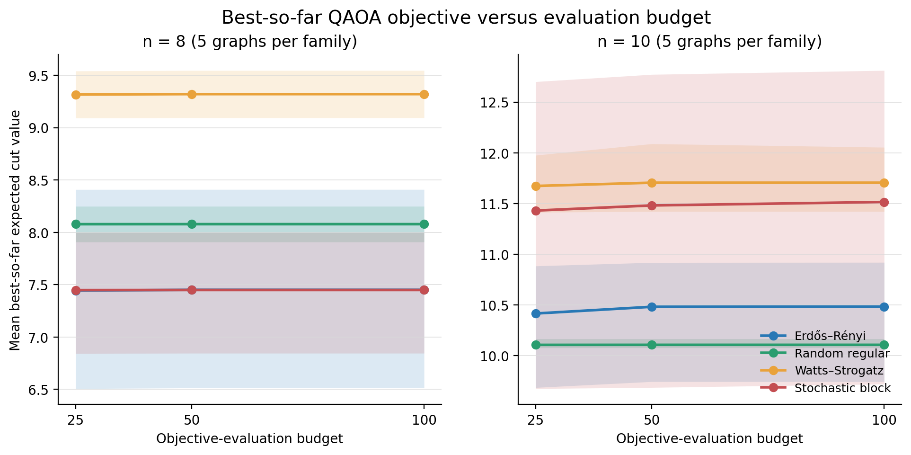
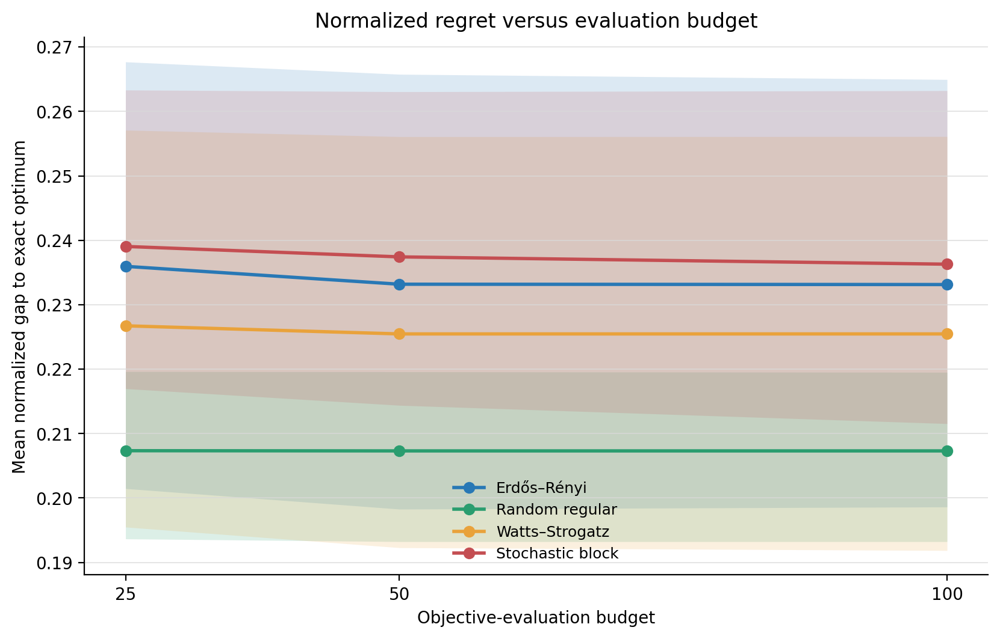
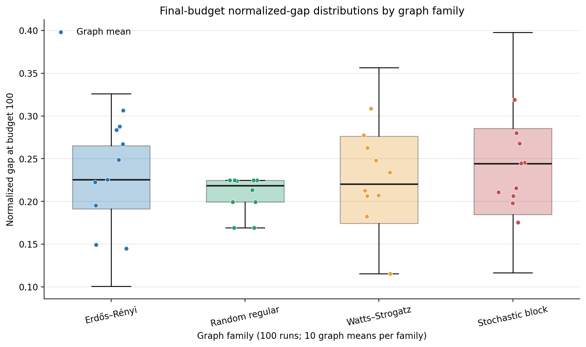

# T29 descriptive pilot analysis

Three application-ready figures were generated from the immutable T28 mandatory
p=1 snapshot. The analysis includes 40 graphs, 400 optimization runs, and 1,200
run-checkpoint rows at budgets 25, 50, and 100.

Uncertainty bands are deterministic 95% percentile bootstrap intervals with
10,000 resamples and seed `20261018`. Resampling occurs over graph-level means,
not individual optimizer seeds, so repeated seeds from the same graph are not
treated as independent graph observations.

## Figure 1 — Best-so-far objective versus budget



Mean best-so-far expected cut value by family and graph size. Each point first
averages the ten optimizer seeds within each graph; lines then average five
graphs per family/size cell. Shaded regions are graph-level 95% bootstrap
intervals. Raw objective values are separated into n=8 and n=10 panels because
cut-value scale depends on graph size and edge count.

## Figure 2 — Normalized regret versus budget



Mean normalized gap to the exact optimum by family. Each family contains ten
graphs and 100 runs. Most visible improvement occurs between budgets 25 and 50;
the mean curves change little from 50 to 100. The wide, overlapping graph-level
intervals counsel against ranking families from mean values alone.

## Figure 3 — Final-budget distributions



Distribution of run-level normalized gaps at budget 100 for each family. Boxes
contain 100 seed runs per family; colored points show the ten graph-level means.
Random-regular instances are comparatively concentrated, while the other
families show materially larger between-graph and/or seed variation.

## Reproducibility and interpretation

The exact graph-level plotting table is `results/T29-analysis/figure-data.csv`.
`figure-provenance.json` records the frozen manifest, source dataset digest,
input metrics checksum, sample counts, bootstrap method, random seed, and hashes
of every PNG and SVG export.

These figures are descriptive evidence from the fixed pilot, not confirmatory
hypothesis tests. They support the conclusion that additional p=1 evaluations
after the first 25–50 calls yielded limited average improvement, while graph
identity remained a substantial source of performance variation.

Recreate all figures with:

```bash
MPLCONFIGDIR=/tmp/qaoa-mpl PYTHONPATH=src \
python -m qaoa_reliability.analysis.pilot_figures \
  --snapshot releases/pilot-v0.1 \
  --output results/T29-analysis
```

The output directory must be fresh to prevent accidental overwrite.
