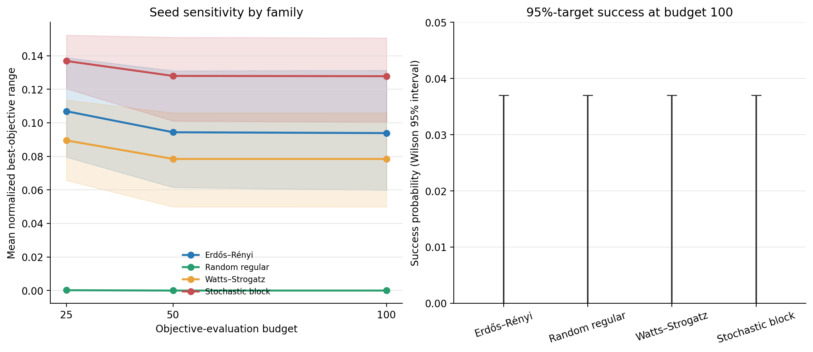

# T30 reliability analysis

T30 quantifies seed sensitivity, success probability, and evaluations-to-target
for the 40-graph mandatory p=1 pilot. Each family contains ten graphs and 100
optimizer runs; each graph contains ten optimizer seeds.

## Seed sensitivity

Seed sensitivity is the within-graph range of best objective values divided by
the exact optimum, then averaged across graphs. At budget 100:

| Family | Graphs | Runs | Mean normalized seed range | Graph-bootstrap 95% interval |
| --- | ---: | ---: | ---: | ---: |
| Erdős–Rényi | 10 | 100 | 0.09389 | [0.05987, 0.13131] |
| Random regular | 10 | 100 | 0.000000009 | [0.000000007, 0.000000011] |
| Watts–Strogatz | 10 | 100 | 0.07848 | [0.04987, 0.10599] |
| Stochastic block model | 10 | 100 | 0.12781 | [0.10039, 0.15065] |

The random-regular instances were effectively insensitive to initialization in
this pilot, while stochastic-block instances showed the largest seed spread.
These are descriptive family comparisons; only ten graphs represent each
family.

## Success and evaluations-to-target

No run in any family reached the frozen 95%-of-exact target at budgets 25, 50,
or 100. At budget 100, each family therefore has observed success probability
0/100 = 0.0, with a two-sided Wilson 95% interval of approximately
[0.0000, 0.0370]. The interval is reported at the run level; dependence among
seeds from the same graph means it should not be interpreted as a graph-population
confidence interval.

Because there were no successes, evaluations-to-target is not estimable. It is
stored as null rather than zero: zero would incorrectly imply immediate target
attainment.

## Reproducibility

`results/T30-analysis/family-reliability.csv` contains all 12
family-by-budget rows, exact sample counts, graph-bootstrap intervals, Wilson
intervals, success counts, and evaluations-to-target fields.
`reliability-report.json` records input and output hashes and the deterministic
10,000-resample bootstrap seed `20261018`.
