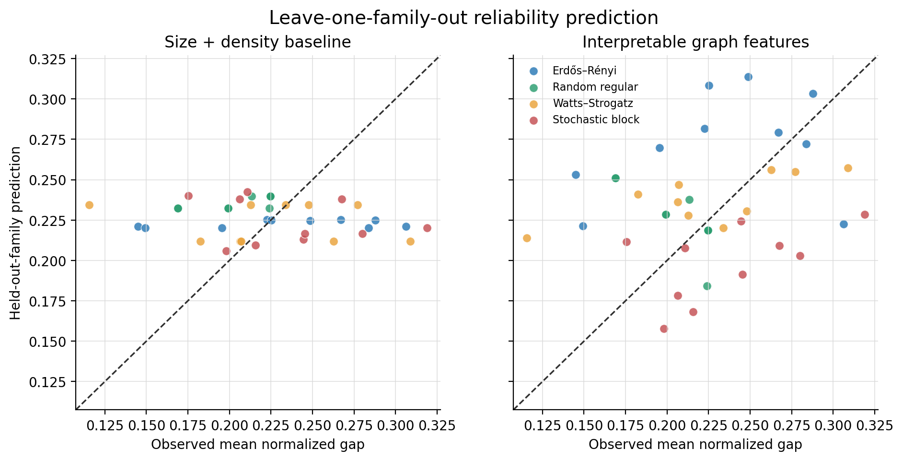

# T31 held-out-family predictive pilot

The predictive target is each graph's mean normalized gap at budget 100. The
study compares a size/density baseline with a small Ridge model using seven
interpretable graph features.

## Leakage-safe design

Each of four folds holds out one entire graph family: 30 graphs train the model
and the ten graphs in the unseen family form the test set. Median imputation and
standardization are fit only on each training fold through a scikit-learn
pipeline. Ridge regularization is fixed at alpha 1.0; no hyperparameter was
tuned on the test families.

- Baseline: `n_nodes`, `density`.
- Expanded model: `n_nodes`, `density`, `degree_std`, `triangle_count`,
  `average_clustering`, `degree_assortativity`, and `diameter`.

## Results

| Model | Pooled MAE | Pooled RMSE | Pooled R² |
| --- | ---: | ---: | ---: |
| Size + density baseline | 0.03797 | 0.04825 | -0.1395 |
| Interpretable graph features | 0.04261 | 0.05206 | -0.3267 |

Baseline-minus-expanded paired MAE improvement was -0.00464, with a graph-level
bootstrap 95% interval of [-0.01395, 0.00450]. Thus the expanded feature model
did not demonstrate an out-of-family improvement. Both pooled R² values were
negative, indicating that neither model generalized better than a constant-mean
reference on these held-out families.

The expanded model improved MAE only for the Watts–Strogatz fold (0.03534 versus
0.03848). It was worse for Erdős–Rényi, random-regular, and stochastic-block
folds. Standardized coefficients are provided for inspection, but they should
not be interpreted causally or ranked as stable feature importance: only 30
training graphs are available in each fold, features are correlated, and the
coefficients vary with the held-out family.

## Artifacts

- `held-out-family-predictions.csv`: one truly held-out prediction per graph.
- `fold-metrics.csv`: sample counts and metrics for all model/family folds.
- `standardized-coefficients.csv`: coefficients fitted in each training fold.
- `predictive-report.json`: validation design, feature sets, pooled metrics,
  paired uncertainty, hashes, and source provenance.
- PNG and SVG observed-versus-predicted figures.

This is a useful negative pilot result: the current small structural feature set
does not support a claim of cross-family prediction beyond size and density.
Larger and more diverse training data would be required before revisiting that
claim.
